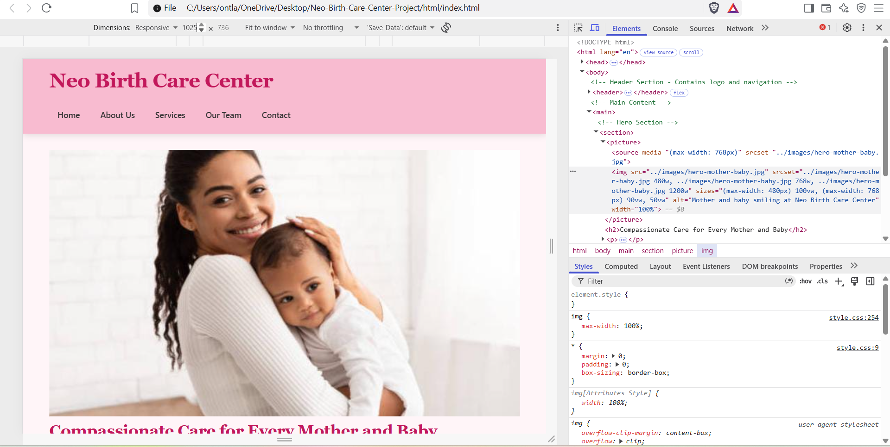
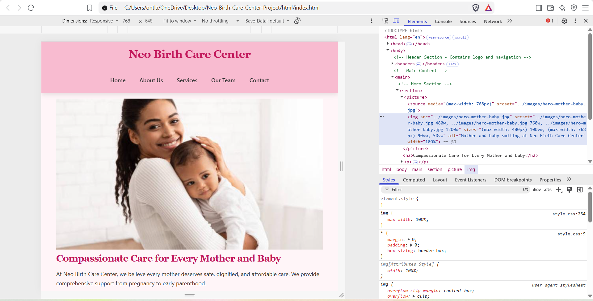
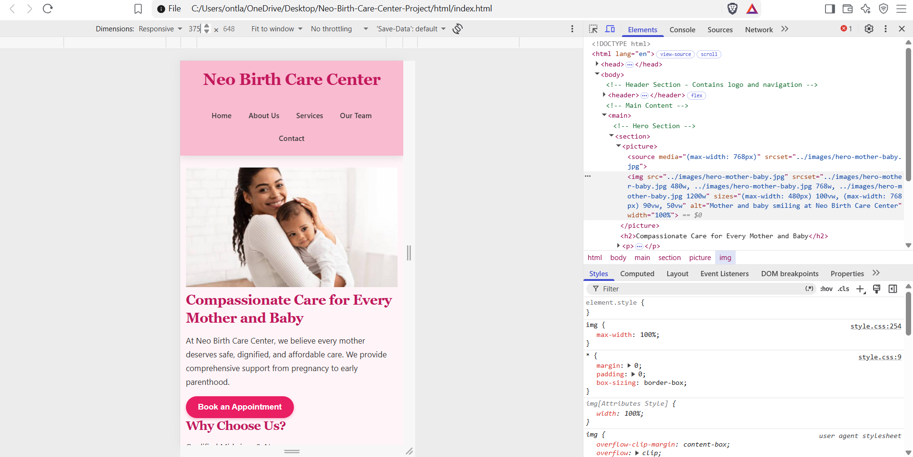

# Neo Birth Care Center - Part 3

## Part 3 Changelog - Working through Feedback from Part 2

#### Part 2 Feedback Fixes (Date: 13 Oct 2026)
- **Feedback Entry 1:** Fixed CSS specificity issues - Lecturer said some inline styles in Part 2 were overriding external stylesheet. Removed all inline styles from all 5 HTML pages.
- **Feedback Entry 2:** Fixed responsive breakpoint overlap - Adjusted media queries from max-width 768px to 768px and 480px to prevent conflict.
- **Feedback Entry 3:** Improved alt text for accessibility - Made alt text more descriptive for screen readers, e.g., changed "baby" to "Newborn baby receiving care at Neo Birth Center".
- **Feedback Entry 4:** Fixed footer not sticking - Added flex layout to body to ensure footer stays at bottom on short pages.

#### Part 3 New Enhancements
- **Date: 13 Oct 2026 - New:** Added JavaScript interactivity - accordion FAQ, Leaflet map, image lightbox gallery, animations
- **Date: 13 Oct 2026 - New:** Implemented dynamic content loading for services with JS array
- **Date: 13 Oct 2026 - New:** Added live search filter for services
- **Date: 13 Oct 2026 - New:** Implemented On-Page SEO - unique title tags, meta descriptions, header tags, image optimization
- **Date: 13 Oct 2026 - New:** Added technical SEO - robots.txt, sitemap.xml, page speed optimization
- **Date: 13 Oct 2026 - New:** Created functional enquiry.html and contact.html forms with HTML5 + JavaScript validation + AJAX simulation

## SEO Keywords Used
Primary: Neo Birth Care Center, newborn care, maternal health, antenatal care South Africa
Secondary: baby clinic Mbombela, neonatal screening, mother and baby support

## References Updated for Part 3
- Leaflet.js - https://leafletjs.com - Interactive map library
- Lightbox2 - https://lokeshdhakar.com/projects/lightbox2/
- Google SEO Starter Guide - https://developers.google.com/search/docs/fundamentals/seo-starter-guide
- MDN - Client-side form validation

## Live Site
Deployed on Netlify: [Add your Netlify link here after deploy]
GitHub: [Your GitHub repo link]# Neo Birth Care Center - WEDE5020 Part 2

Live Site: https://your-username.github.io/Neo-Birth-Care-Center-Project/html/index.html

## Part 2 Updates

### 1. Working through Feedback - Changelog (REQUIRED)

#### Date: 24 Sep 2026 - Feedback Entry 1: Navigation Inconsistency
- **Issue from Part 1:** Navigation menu was different on contact.html vs other pages.
- **Fix:** Made header identical on all 5 pages (index, about, services, team, contact) and added active link highlighting.

#### Date: 24 Sep 2026 - Feedback Entry 2: Missing Alt Attributes
- **Issue from Part 1:** Hero image missing alt text for accessibility.
- **Fix:** Added descriptive alt attributes to ALL images. Example: alt="Mother and baby smiling at Neo Birth Care Center"

#### Date: 24 Sep 2026 - Feedback Entry 3: Broken Image Paths
- **Issue from Part 1:** Images not showing on GitHub Pages because path was css/style.css instead of ../css/style.css and images/ instead of ../images/
- **Fix:** Fixed all relative paths to use ../images/ and ../css/ because html files are inside /html folder while images and css are outside.

#### Date: 24 Sep 2026 - Feedback Entry 4: Missing Viewport Tag
- **Issue from Part 1:** Website not responsive on mobile - viewport meta tag was missing.
- **Fix:** Added <meta name="viewport" content="width=device-width, initial-scale=1.0"> to all pages.

### 2. CSS Styling (Part 2)

#### 2.1 External Stylesheet
- Created external css/style.css and linked to all 5 pages using <link rel="stylesheet" href="../css/style.css">

#### 2.2 Base Style + Reset
- Added CSS Reset * { margin:0; padding:0; box-sizing:border-box; }
- Defined :root variables for colors, base font 16px, body line-height 1.7

#### 2.3 Typography
- Font-family: Georgia for headings, Segoe UI for body
- Typography scale: h1 2.5rem, h2 2rem, h3 1.5rem, p 1rem
- line-height, font-weight, letter-spacing implemented

#### 2.4 Layout
- Header uses Flexbox: display:flex; justify-content:space-between; align-items:center
- Hero section uses Grid: display:grid; grid-template-columns:1fr 1fr;
- Services uses Grid: grid-template-columns:repeat(2, 1fr)

#### 2.5 Visual Styles
- Colors: --primary #e91e63 pink
- Pseudo-classes: nav a:hover, button:hover, card:hover, :focus, :active
- Box-shadow, border-radius, transitions

### 3. Responsive Design

#### 3.1 Breakpoints + Media Queries
- Tablet: @media (max-width: 768px) - changes grid to single column, header to column
- Mobile: @media (max-width: 480px) - 95% width, smaller fonts, centered nav
- Desktop default is 1024px+ with 2 columns

#### 3.2 Relative Units
- Used rem for fonts and padding, % for widths (width:90%, 100%), em for margins, vw for responsive images

#### 3.3 Responsive Images
- Implemented <picture> element with <source media="(max-width:768px)">
- Used srcset with 480w, 768w, 1200w and sizes attribute: sizes="(max-width:480px) 100vw, (max-width:768px) 90vw, 50vw"

#### 3.4 Testing
- Tested using Chrome DevTools > Device Toolbar (Ctrl+Shift+M) at 375px mobile, 768px tablet, 1024px desktop

### Screenshots

#### Desktop 1024px

#### Tablet 768px

#### Mobile 375px

Testing done with Chrome DevTools Device Toolbar at 375px, 768px, 1024px

To take screenshots: Open site in Chrome > Press F12 > Click phone icon > Select dimensions > Screenshot

### References
- Images: Unsplash.com (mother and baby images, royalty free)
- W3Schools - CSS Flexbox, Grid, Media Queries
- MDN Web Docs - Responsive images srcset, sizes, picture
- Google Fonts - Typography

### How to Run
1. Download ZIP from GitHub
2. Extract
3. Open html/index.html in browser
